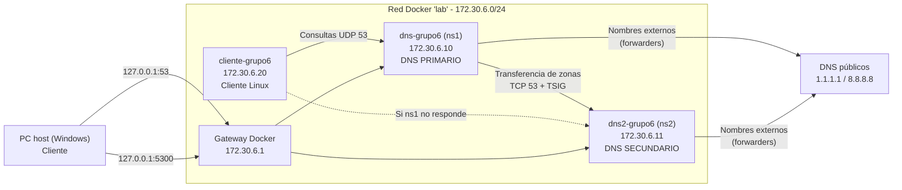
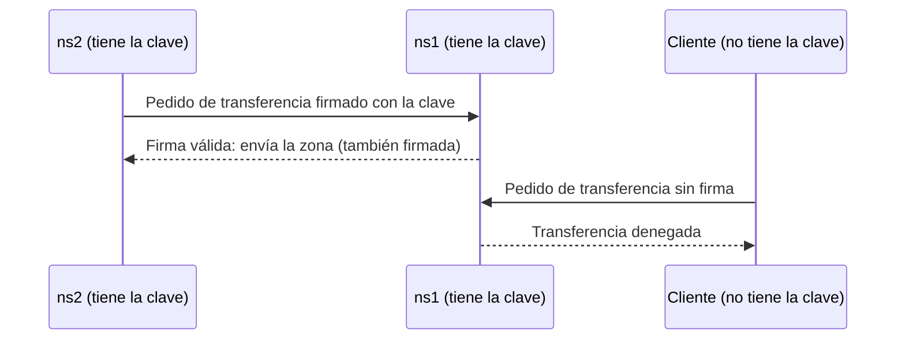
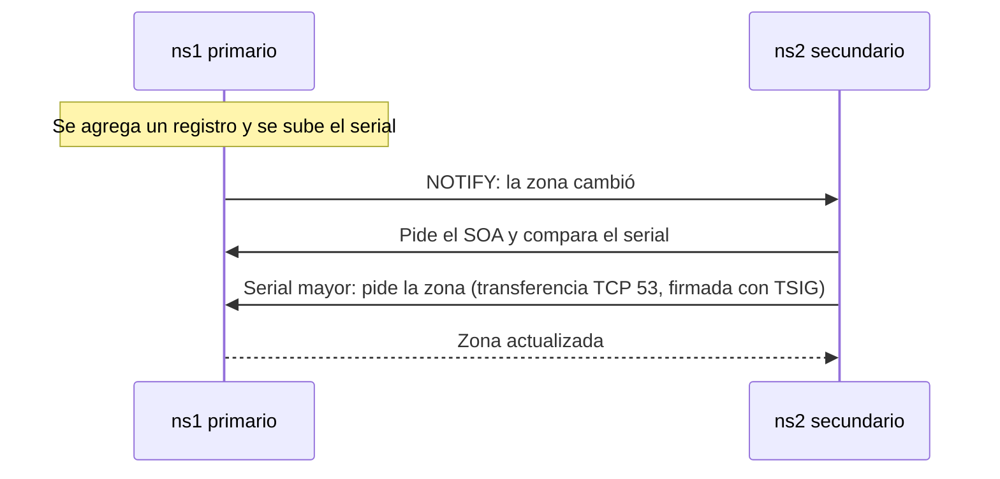

# TP6 - Implementación de un servidor DNS (Grupo 6)

Redes de Datos - UTN FRC

## Índice

1. [Integrantes](#integrantes)
2. [Descripción](#descripción)
3. [Topología](#topología)
4. [Estructura de archivos](#estructura-de-archivos)
5. [Configuración](#configuración)
   - [Servidores](#servidores)
   - [Autenticación de transferencias (TSIG)](#autenticación-de-transferencias-tsig)
   - [Resolución de nombres externos](#resolución-de-nombres-externos)
   - [Zona directa](#zona-directa)
   - [Zona inversa](#zona-inversa)
   - [Campos del SOA](#campos-del-soa)
   - [Clientes](#clientes)
6. [Requisitos](#requisitos)
7. [Uso](#uso)
   - [Primera vez: generar la clave TSIG](#primera-vez-generar-la-clave-tsig)
   - [Comandos habituales](#comandos-habituales)
   - [Scripts](#scripts)
8. [Pruebas](#pruebas)
   - [Desde el cliente Linux](#desde-el-cliente-linux)
   - [Desde la PC host](#desde-la-pc-host)
9. [Flujos](#flujos)
   - [Propagación de un cambio del primario al secundario](#propagación-de-un-cambio-del-primario-al-secundario)
   - [Redundancia: caída del primario](#redundancia-caída-del-primario)
   - [Autenticación de transferencias con TSIG](#autenticación-de-transferencias-con-tsig)
10. [Cómo aplicar cambios](#cómo-aplicar-cambios)
    - [El serial](#el-serial)
11. [Reiniciar el laboratorio desde cero](#reiniciar-el-laboratorio-desde-cero)
12. [Notas y problemas comunes](#notas-y-problemas-comunes)
13. [Preguntas y situaciones frecuentes](#preguntas-y-situaciones-frecuentes)
    - [Caídas y conectividad](#caídas-y-conectividad)
    - [Serial, sintaxis y caché](#serial-sintaxis-y-caché)
    - [Diseño y seguridad](#diseño-y-seguridad)

## Integrantes

| Apellido, Nombre               | Legajo |
| ------------------------------ | ------ |
| Arce Sayago, Camila            | 94309  |
| Alves, Rocío                   | 94215  |
| Carranza Duobaltis, Candelaria | 402600 |
| Martínez Agliozzo, Luz María   | 94415  |
| Paná, Matías Aarón             | 95165  |

---

## Descripción

Implementación de un servicio **DNS (Domain Name System)** con contenedores Docker. DNS traduce nombres de dominio a direcciones IP.

Se configuró un dominio propio, **`grupo6.lab`**, con dos servidores autorizados:

- **ns1 (primario):** tiene los archivos originales de las zonas.
- **ns2 (secundario):** copia las zonas desde ns1 automáticamente, autenticándose con una clave **TSIG**, y aporta redundancia.

El servicio se consume desde dos clientes: un **contenedor Linux** y la **PC host (Windows)**.

| Elemento                      | Detalle                                                                                                                  |
| ----------------------------- | ------------------------------------------------------------------------------------------------------------------------ |
| Servicio                      | DNS                                                                                                                      |
| Software del servidor         | BIND 9.20 (imagen oficial `internetsystemsconsortium/bind9:9.20`)                                                        |
| Software del cliente          | `dig` y `nslookup` (paquete `bind-tools` en Alpine Linux) y `nslookup` de Windows                                        |
| Protocolo y puerto            | UDP 53 para consultas y TCP 53 para transferencias de zona y respuestas grandes (puerto por defecto)                     |
| Puertos publicados en el host | `127.0.0.1:53` → ns1 (puerto por defecto); `127.0.0.1:5300` → ns2 (puerto distinto, porque el 53 del host ya lo usa ns1) |
| Seguridad                     | Transferencias de zona autenticadas con TSIG (`hmac-sha256`); recursión limitada a la red del laboratorio                |

---

## Topología



| Equipo            | Contenedor       | IP          | Rol                                                                            | Puerto en el host |
| ----------------- | ---------------- | ----------- | ------------------------------------------------------------------------------ | ----------------- |
| ns1               | `dns-grupo6`     | 172.30.6.10 | DNS primario, autorizado de `grupo6.lab`                                       | `127.0.0.1:53`    |
| ns2               | `dns2-grupo6`    | 172.30.6.11 | DNS secundario, autorizado de `grupo6.lab`                                     | `127.0.0.1:5300`  |
| Cliente Linux     | `cliente-grupo6` | 172.30.6.20 | Cliente DNS (usa ns1 y, si falla, ns2)                                         | -                 |
| PC host           | -                | -           | Cliente DNS a través de los puertos publicados                                 | -                 |
| Gateway de Docker | -                | 172.30.6.1  | Salida de la red. Las consultas del host llegan a los servidores desde esta IP | -                 |

Desde Windows no se puede llegar directamente a las IP `172.30.6.x`, porque Docker Desktop no las expone. Por eso el host consulta a través de `127.0.0.1` y los puertos publicados.

---

## Estructura de archivos

```
RDD_GRUPO6_TP6_DNS/
├── docker-compose.yaml          → Define los 3 contenedores, sus IP, puertos y la red
├── README.md                    → Este documento
├── .gitignore                   → Excluye la clave TSIG del repositorio
├── .gitattributes               → Fuerza saltos de línea Linux (LF) en los scripts
├── scripts/
│   ├── setup.sh                 → Genera la clave TSIG (si falta) y levanta el laboratorio
│   ├── pruebas.sh               → Ejecuta todas las pruebas
│   └── reset.sh                 → Vuelve el laboratorio al estado inicial
├── bind/
│   ├── named.conf               → Configuración del servidor primario (ns1)
│   ├── named-secundario.conf    → Configuración del servidor secundario (ns2)
│   ├── db.lab                   → Zona directa grupo6.lab (nombre → IP)
│   ├── db.172.30.6              → Zona inversa 172.30.6.0/24 (IP → nombre)
│   ├── tsig.key                 → Clave TSIG compartida por ns1 y ns2 (secreta: no se sube al repositorio, se genera)
│   └── original/                → Copia de las zonas en su estado inicial (la usa reset.sh)
│       ├── db.lab
│       └── db.172.30.6
└── client/
    └── Dockerfile               → Imagen del cliente: Alpine Linux con dig y nslookup
```

Todos los archivos de configuración tienen comentarios que explican cada línea. `bind/tsig.key` no está en el repositorio: se genera la primera vez (ver [Primera vez: generar la clave TSIG](#primera-vez-generar-la-clave-tsig)).

---

## Configuración

### Servidores

| Configuración                            | ns1 (primario)                                         | ns2 (secundario)                                                               |
| ---------------------------------------- | ------------------------------------------------------ | ------------------------------------------------------------------------------ |
| Tipo de zona                             | `primary`: tiene los archivos originales               | `secondary`: copia las zonas de ns1                                            |
| Archivos de zona                         | `db.lab` y `db.172.30.6`, montados desde `bind/`       | No tiene propios. Guarda las copias en `/var/cache/bind` dentro del contenedor |
| Consultas (`allow-query`)                | Cualquiera                                             | Cualquiera                                                                     |
| Recursión (`allow-recursion`)            | Solo la red `172.30.6.0/24`                            | Solo la red `172.30.6.0/24`                                                    |
| Transferencia de zona (`allow-transfer`) | Solo a pedidos firmados con la clave `transfer-grupo6` | -                                                                              |
| Pedido de zonas (`primaries`)            | -                                                      | Pide las zonas a ns1 firmando con la clave `transfer-grupo6`                   |
| Aviso de cambios (`also-notify`)         | Avisa a ns2 cuando la zona cambia                      | -                                                                              |

- **Ambos servidores son autorizados:** sus respuestas sobre `grupo6.lab` llevan el flag `aa`.
- **Por qué la transferencia está restringida:** sin `allow-transfer`, cualquiera podría descargar la zona completa, es decir, la lista de todos los equipos del dominio.

### Autenticación de transferencias (TSIG)

Las transferencias de zona entre ns1 y ns2 se autentican con **TSIG** (Transaction Signature). Los dos servidores comparten una clave secreta y cada pedido de transferencia va **firmado** con ella. ns1 solo entrega la zona si la firma es válida.



| Elemento        | Valor                                                                                    |
| --------------- | ---------------------------------------------------------------------------------------- |
| Archivo         | `bind/tsig.key`, montado en ns1 y ns2 e incluido en ambas configuraciones con `include`  |
| Nombre de clave | `transfer-grupo6`                                                                        |
| Algoritmo       | `hmac-sha256`                                                                            |
| En ns1          | `allow-transfer { key "transfer-grupo6"; };`: entrega la zona solo a pedidos firmados    |
| En ns2          | `primaries { 172.30.6.10 key "transfer-grupo6"; };`: firma los pedidos que le hace a ns1 |

- **Autoriza la clave, no la IP.** Una IP se puede falsificar; la firma no se puede generar sin la clave.
- **La clave es secreta:** está excluida del repositorio con `.gitignore` y se genera en cada instalación.
- **Solo protege la comunicación entre servidores.** Los clientes hacen sus consultas normales sin clave.

### Resolución de nombres externos

Para nombres que no son de sus zonas, como `google.com`, ambos servidores **reenvían la consulta** a los DNS públicos `1.1.1.1` (Cloudflare) y `8.8.8.8` (Google) mediante `forwarders` y `forward only`.

- Estas respuestas son **no autoritativas**: vienen de otro servidor, no del dueño del dominio.
- La recursión se limita a la red del laboratorio para no funcionar como "resolvedor abierto". Las consultas del host llegan desde el gateway `172.30.6.1`, que está dentro de esa red.

### Zona directa

Zona `grupo6.lab`, archivo `bind/db.lab`

| Nombre               | Tipo  | Valor                                  | Significado                                                                              |
| -------------------- | ----- | -------------------------------------- | ---------------------------------------------------------------------------------------- |
| `grupo6.lab`         | SOA   | `ns1.grupo6.lab.`, serial `2026110201` | Datos de la zona: servidor primario, responsable (`admin@grupo6.lab`), versión y tiempos |
| `grupo6.lab`         | NS    | `ns1.grupo6.lab.`                      | Servidor autorizado (primario)                                                           |
| `grupo6.lab`         | NS    | `ns2.grupo6.lab.`                      | Servidor autorizado (secundario)                                                         |
| `grupo6.lab`         | MX    | `10 mail.grupo6.lab.`                  | Servidor de correo del dominio, prioridad 10                                             |
| `ns1.grupo6.lab`     | A     | 172.30.6.10                            | IP del primario                                                                          |
| `ns2.grupo6.lab`     | A     | 172.30.6.11                            | IP del secundario                                                                        |
| `www.grupo6.lab`     | A     | 172.30.6.10                            | Nombre de ejemplo de un servidor web                                                     |
| `mail.grupo6.lab`    | A     | 172.30.6.10                            | Nombre del servidor de correo                                                            |
| `cliente.grupo6.lab` | A     | 172.30.6.20                            | Cliente Linux                                                                            |
| `web.grupo6.lab`     | CNAME | `www.grupo6.lab`                       | Alias de `www`                                                                           |

`www` y `mail` son **solo registros DNS** para mostrar cada tipo: no hay un servidor web ni de correo funcionando.

### Zona inversa

Zona `6.30.172.in-addr.arpa`, archivo `bind/db.172.30.6`

La resolución inversa (IP → nombre) usa la IP con los octetos invertidos bajo el dominio especial `in-addr.arpa`. Por ejemplo, para `172.30.6.20` se consulta `20.6.30.172.in-addr.arpa`.

| Registro | Tipo | Valor                 |
| -------- | ---- | --------------------- |
| `10`     | PTR  | `ns1.grupo6.lab.`     |
| `11`     | PTR  | `ns2.grupo6.lab.`     |
| `20`     | PTR  | `cliente.grupo6.lab.` |

También tiene su propio SOA (serial `2026110201`) y los NS de ns1 y ns2.

### Campos del SOA

| Campo        | Valor        | Significado                                                                                  |
| ------------ | ------------ | -------------------------------------------------------------------------------------------- |
| serial       | `2026110201` | Versión de la zona, en formato AAAAMMDDnn. Ver [Cómo aplicar cambios](#cómo-aplicar-cambios) |
| refresh      | 3600         | Cada cuánto el secundario consulta si la zona cambió (1 h)                                   |
| retry        | 900          | Reintento si falló el refresh (15 min)                                                       |
| expire       | 604800       | Si el secundario no contacta al primario en este tiempo, deja de responder (7 días)          |
| TTL negativo | 300          | Cuánto se guarda en caché una respuesta de "no existe" (5 min)                               |

### Clientes

| Cliente          | Configuración DNS                                                                                                                                |
| ---------------- | ------------------------------------------------------------------------------------------------------------------------------------------------ |
| Contenedor Linux | `dns: [172.30.6.10, 172.30.6.11]` en el compose: usa ns1 y, si no responde, ns2                                                                  |
| PC host          | Se indica el servidor en cada consulta: `127.0.0.1` (ns1) o `127.0.0.1` puerto 5300 (ns2). La configuración de red de Windows **no se modifica** |

---

## Requisitos

- **Windows:** Docker Desktop con Docker Compose, en modo **Linux containers**. Los comandos se pueden ejecutar desde PowerShell o desde WSL.
- **Linux:** Docker Engine con el plugin Docker Compose.
- **Puertos libres en el host:** `53` (UDP/TCP) y `5300` (UDP/TCP) en `127.0.0.1`.
- **Conexión a Internet:** para descargar las imágenes y para resolver nombres externos.
- **WSL/Linux:** si `nslookup` o `dig` no están instalados:
  ```bash
  sudo apt install dnsutils
  ```
- **WSL:** para consultar a `127.0.0.1` desde WSL, Docker Desktop tiene que tener habilitada la integración con la distribución (Settings → Resources → WSL integration).

---

## Uso

Todos los comandos se ejecutan desde la carpeta del proyecto.

### Primera vez: generar la clave TSIG

La clave no está en el repositorio, así que hay que generarla **antes del primer `docker compose up`**. Sin ella, los servidores no arrancan.

```powershell
# PowerShell
docker run --rm --entrypoint tsig-keygen internetsystemsconsortium/bind9:9.20 -a hmac-sha256 transfer-grupo6 | Out-File -Encoding ascii bind/tsig.key

# WSL/Linux
docker run --rm --entrypoint tsig-keygen internetsystemsconsortium/bind9:9.20 -a hmac-sha256 transfer-grupo6 > bind/tsig.key
```

| Parte                                   | Qué hace                                                                                                    |
| --------------------------------------- | ----------------------------------------------------------------------------------------------------------- |
| `docker run --rm`                       | Ejecuta un contenedor temporal, que se elimina al terminar                                                  |
| `--entrypoint tsig-keygen`              | En lugar de iniciar el servidor, ejecuta la herramienta de BIND que genera claves TSIG                      |
| `-a hmac-sha256`                        | Algoritmo de firma                                                                                          |
| `transfer-grupo6`                       | Nombre de la clave: ns1 y ns2 la referencian con este nombre                                                |
| `Out-File -Encoding ascii` (PowerShell) | Guarda el archivo como texto simple. Con `>`, PowerShell usa una codificación que BIND no lee correctamente |

El archivo `bind/tsig.key` debe quedar así, con otro valor en `secret`:

```
key "transfer-grupo6" {
	algorithm hmac-sha256;
	secret "aBcD...==";
};
```

### Comandos habituales

Son iguales en PowerShell y en WSL/Linux.

| Acción                             | Comando                                             |
| ---------------------------------- | --------------------------------------------------- |
| Levantar el laboratorio            | `docker compose up -d --build`                      |
| Ver el estado de los contenedores  | `docker compose ps`                                 |
| Ver los logs de ns1                | `docker compose logs dns`                           |
| Ver los logs de ns2                | `docker compose logs dns2`                          |
| Seguir los logs en vivo            | `docker compose logs -f dns dns2`                   |
| Abrir una terminal en el cliente   | `docker compose exec cliente sh` (salir con `exit`) |
| Apagar sin borrar                  | `docker compose stop`                               |
| Volver a encender                  | `docker compose start`                              |
| Apagar y borrar contenedores y red | `docker compose down`                               |

**Verificación del arranque:** en los logs deben aparecer:

- ns1: `zone grupo6.lab/IN: loaded serial 2026110201` y lo mismo para `6.30.172.in-addr.arpa`.
- ns2: `Transfer completed` y `transferred serial 2026110201` para cada zona. Si la clave no coincide, en cambio aparecen errores TSIG (ver [Notas y problemas comunes](#notas-y-problemas-comunes)).

### Scripts

Automatizan la instalación, las pruebas y el reinicio. Se ejecutan desde **Git Bash o WSL**, en la carpeta del proyecto. Desde PowerShell no se ejecutan directamente; con WSL instalado se puede usar `wsl bash scripts/setup.sh`.

| Script                    | Qué hace                                                                                                                                 |
| ------------------------- | ---------------------------------------------------------------------------------------------------------------------------------------- |
| `bash scripts/setup.sh`   | Genera la clave TSIG si no existe (o si Docker creó una carpeta en su lugar), levanta el laboratorio y muestra las transferencias de ns2 |
| `bash scripts/pruebas.sh` | Ejecuta todas las pruebas desde el cliente Linux y desde el host, con un título por prueba                                               |
| `bash scripts/reset.sh`   | Pide confirmación, restaura las zonas desde `bind/original/` y recrea todo desde cero. La clave TSIG se conserva                         |

Los scripts deben tener saltos de línea **LF**. Con git, lo asegura `.gitattributes`. Sin git, verificarlo en el editor (en VS Code, en la barra inferior derecha).

---

## Pruebas

### Desde el cliente Linux

Primero se abre una terminal en el cliente, igual en PowerShell y WSL/Linux:

```bash
docker compose exec cliente sh
```

Ya dentro del cliente:

| Prueba                      | Comando                                                                             | Resultado esperado                                                    |
| --------------------------- | ----------------------------------------------------------------------------------- | --------------------------------------------------------------------- |
| Registro A                  | `dig @172.30.6.10 www.grupo6.lab`                                                   | `status: NOERROR`, flag `aa`, `www.grupo6.lab. 3600 IN A 172.30.6.10` |
| Alias (CNAME)               | `dig @172.30.6.10 web.grupo6.lab`                                                   | CNAME a `www.grupo6.lab` y su registro A                              |
| Correo (MX)                 | `dig @172.30.6.10 grupo6.lab MX`                                                    | `10 mail.grupo6.lab.`                                                 |
| Servidores autorizados (NS) | `dig @172.30.6.10 grupo6.lab NS`                                                    | `ns1.grupo6.lab.` y `ns2.grupo6.lab.`                                 |
| Datos de la zona (SOA)      | `dig @172.30.6.10 grupo6.lab SOA`                                                   | SOA con serial `2026110201`                                           |
| Resolución inversa (PTR)    | `dig @172.30.6.10 -x 172.30.6.20`                                                   | `cliente.grupo6.lab.`                                                 |
| Nombre inexistente          | `dig @172.30.6.10 noexiste.grupo6.lab`                                              | `status: NXDOMAIN`                                                    |
| Nombre externo              | `dig @172.30.6.10 google.com`                                                       | Una IP, **sin** flag `aa` (respuesta no autoritativa)                 |
| Secundario                  | `dig @172.30.6.11 www.grupo6.lab`                                                   | Igual que en ns1, con flag `aa`: ns2 también es autorizado            |
| Mismo serial en ambos       | `dig @172.30.6.10 grupo6.lab SOA +short` y `dig @172.30.6.11 grupo6.lab SOA +short` | Mismo serial en los dos                                               |
| Transferencia sin clave     | `dig @172.30.6.10 grupo6.lab AXFR`                                                  | `Transfer failed`: la transferencia exige la clave TSIG               |
| Transferencia con clave     | `dig @172.30.6.10 grupo6.lab AXFR -y hmac-sha256:transfer-grupo6:SECRET`            | La zona completa y, al final, un registro `TSIG` con `NOERROR`        |
| Uso del DNS por el sistema  | `ping -c 2 www.grupo6.lab`                                                          | Resuelve a `172.30.6.10` y responde                                   |

`SECRET` es el valor del campo `secret` de `bind/tsig.key`. Ver [Autenticación de transferencias con TSIG](#autenticación-de-transferencias-con-tsig).

Para ejecutar una prueba sin entrar a la terminal del cliente, el `@servidor` va **entre comillas simples**. Así el comando funciona igual en PowerShell y en WSL/Linux:

```bash
docker compose exec cliente dig '@172.30.6.10' www.grupo6.lab
```

### Desde la PC host

Los comandos son iguales en PowerShell y en WSL/Linux (en WSL puede hacer falta instalar `dnsutils`, ver [Requisitos](#requisitos)).

| Prueba             | Comando                                        | Resultado esperado                                      |
| ------------------ | ---------------------------------------------- | ------------------------------------------------------- |
| Registro A en ns1  | `nslookup www.grupo6.lab 127.0.0.1`            | `172.30.6.10`, sin la línea "Respuesta no autoritativa" |
| Registro A en ns2  | `nslookup -port=5300 www.grupo6.lab 127.0.0.1` | `172.30.6.10`                                           |
| Correo (MX)        | `nslookup -type=MX grupo6.lab 127.0.0.1`       | `mail exchanger = mail.grupo6.lab`                      |
| Resolución inversa | `nslookup 172.30.6.20 127.0.0.1`               | `cliente.grupo6.lab`                                    |
| Nombre externo     | `nslookup google.com 127.0.0.1`                | Una IP, con la línea **"Respuesta no autoritativa"**    |

En WSL/Linux también se puede usar `dig`: `dig @127.0.0.1 www.grupo6.lab` o, para ns2, `dig @127.0.0.1 -p 5300 www.grupo6.lab`.

---

## Flujos

### Propagación de un cambio del primario al secundario

Muestra cómo ns2 se actualiza solo cuando cambia la zona en ns1, y **por qué existe el serial**.



1. En `bind/db.lab`, agregar el registro:
   ```
   prueba  IN  A  172.30.6.50
   ```
   y subir el serial de `2026110201` a `2026110202`.
2. Reiniciar el primario y ver la transferencia en los logs de ns2 (iguales en PowerShell y WSL/Linux):
   ```bash
   docker compose restart dns
   docker compose logs dns2 --tail 10
   ```
   Debe aparecer una transferencia con el serial `2026110202`.
3. Consultar el registro nuevo **a ns2**:
   ```bash
   docker compose exec cliente dig '@172.30.6.11' prueba.grupo6.lab
   ```
   Responde `172.30.6.50`: el cambio se hizo solo en ns1 y llegó a ns2.

**El caso de no subir el serial:** si se agrega otro registro pero **no** se sube el serial, ns2 compara, ve el mismo número, asume que no hubo cambios y **no copia la zona**. ns1 responde el registro nuevo y ns2 no. Es la mejor demostración de por qué existe el serial.

Para dejar la zona como estaba al terminar, ver [Reiniciar el laboratorio desde cero](#reiniciar-el-laboratorio-desde-cero).

### Redundancia: caída del primario

Muestra que, si ns1 deja de funcionar, los clientes siguen resolviendo nombres con ns2. Los comandos son iguales en PowerShell y WSL/Linux.

1. Apagar ns1:
   ```bash
   docker compose stop dns
   ```
2. Consultar a ns2: responde con flag `aa`.
   ```bash
   docker compose exec cliente dig '@172.30.6.11' www.grupo6.lab
   ```
3. Usar un nombre desde el cliente sin indicar servidor:
   ```bash
   docker compose exec cliente ping -c 2 ns2.grupo6.lab
   ```
   El nombre se resuelve y el equipo responde: el cliente pasó a usar ns2.
4. Volver a encender ns1:
   ```bash
   docker compose start dns
   ```

**Resolver no es lo mismo que llegar:** `ping www.grupo6.lab` con ns1 apagado **resuelve el nombre** (la primera línea muestra `172.30.6.10`), pero **no recibe respuesta**. `www` apunta a la IP de ns1, que es justamente el equipo apagado. El DNS funcionó; lo que falla es la conectividad con ese equipo.

### Autenticación de transferencias con TSIG

Muestra que la zona completa solo se entrega a quien tiene la clave, sin importar desde qué IP se pida.

1. Pedir la zona desde el cliente **sin clave** (igual en PowerShell y WSL/Linux):
   ```bash
   docker compose exec cliente dig '@172.30.6.10' grupo6.lab AXFR
   ```
   Resultado: `; Transfer failed.`
2. Ver el valor de la clave:

   ```powershell
   # PowerShell
   Get-Content bind/tsig.key

   # WSL/Linux
   cat bind/tsig.key
   ```

3. Pedir la zona **con la clave**, reemplazando `SECRET` por el valor del campo `secret` (igual en PowerShell y WSL/Linux):
   ```bash
   docker compose exec cliente dig '@172.30.6.10' grupo6.lab AXFR -y 'hmac-sha256:transfer-grupo6:SECRET'
   ```
   Resultado: la zona completa y, al final, un registro `TSIG` con `NOERROR`. **Desde la misma IP que antes fue rechazada**, ahora se permite: lo que autoriza es la clave.
4. Repetir con una clave incorrecta, cambiando algún carácter de `SECRET`. Resultado: error de verificación TSIG (`BADSIG` o `tsig verify failure`).
5. Ver en los logs de ns1 las transferencias aceptadas y denegadas (igual en PowerShell y WSL/Linux):
   ```bash
   docker compose logs dns --tail 15
   ```

---

## Cómo aplicar cambios

| Qué se modificó                              | Qué hacer                                                                                                                                                |
| -------------------------------------------- | -------------------------------------------------------------------------------------------------------------------------------------------------------- |
| Un archivo de zona (`db.lab`, `db.172.30.6`) | Subir el serial de ese archivo y ejecutar `docker compose restart dns`. ns2 se actualiza solo.                                                           |
| `named.conf`                                 | `docker compose restart dns`                                                                                                                             |
| `named-secundario.conf`                      | `docker compose restart dns2`                                                                                                                            |
| La clave TSIG (`tsig.key`)                   | Generar una nueva (ver [Primera vez](#primera-vez-generar-la-clave-tsig)) y ejecutar `docker compose restart dns dns2`: los dos tienen que usar la misma |
| `docker-compose.yaml`                        | `docker compose up -d`                                                                                                                                   |
| `client/Dockerfile`                          | `docker compose up -d --build`                                                                                                                           |

Todos los comandos de `docker compose` son iguales en PowerShell y WSL/Linux. Los archivos de zona **solo se editan en ns1**; ns2 no tiene archivos propios.

### El serial

El serial es el **número de versión de la zona**. Se usa el formato `AAAAMMDDnn`: la fecha más un contador de cambios de ese día.

- Primer cambio del 2 de noviembre de 2026: `2026110201`.
- Segundo cambio del mismo día: `2026110202`.
- Primer cambio del día siguiente: `2026110301`.

ns2 compara su serial con el de ns1 y **solo copia la zona si el de ns1 es mayor**. Por eso el serial tiene que subir en cada cambio y nunca bajar. También sirve para verificar que un cambio se cargó: consultando el SOA se ve qué versión tiene cada servidor.

---

## Reiniciar el laboratorio desde cero

Deja todo como en el primer lanzamiento. Sirve, por ejemplo, después de mostrar el flujo de propagación.

**Forma rápida:** `bash scripts/reset.sh` (Git Bash o WSL) hace todos estos pasos. A continuación, el procedimiento manual.

1. En `bind/db.lab`, borrar los registros de prueba (por ejemplo `prueba`) y volver el serial a `2026110201`.
2. En `bind/db.172.30.6`, volver el serial a `2026110201` si se modificó.
3. Eliminar todo y volver a levantar (iguales en PowerShell y WSL/Linux):
   ```bash
   docker compose down -v
   docker compose up -d --build
   ```

| Comando         | Qué hace                                                                                                      |
| --------------- | ------------------------------------------------------------------------------------------------------------- |
| `down`          | Elimina los contenedores y la red                                                                             |
| `-v`            | Elimina también los volúmenes que haya creado Docker, para asegurar que se borre la copia de las zonas de ns2 |
| `up -d --build` | Crea todo desde cero y reconstruye la imagen del cliente                                                      |

La clave TSIG **se conserva**: está en `bind/`, fuera de los contenedores.

**Por qué no alcanza con un `restart`:** ns2 guarda su copia de las zonas con el serial más alto que recibió. Si se baja el serial y solo se reinicia, ns2 ve que su copia es "más nueva" que la del primario y **no la actualiza**, así que sigue respondiendo con los datos viejos. Borrar los contenedores elimina esa copia, y ns2 vuelve a copiar la zona desde cero.

---

## Notas y problemas comunes

| Situación                                                          | Causa                                                                                                  | Solución                                                                                                                                                                                                                                                                                                                                                    |
| ------------------------------------------------------------------ | ------------------------------------------------------------------------------------------------------ | ----------------------------------------------------------------------------------------------------------------------------------------------------------------------------------------------------------------------------------------------------------------------------------------------------------------------------------------------------------- |
| `error during connect ... dockerDesktopLinuxEngine`                | Docker Desktop no está corriendo                                                                       | Abrir Docker Desktop y esperar a que diga "Engine running". Verificar con `docker version`: tiene que mostrar las secciones Client y Server                                                                                                                                                                                                                 |
| PowerShell da `ParserError` al usar `dig @...`                     | En PowerShell, `@` es un operador especial                                                             | Escribir el servidor entre comillas simples: `'@172.30.6.10'`. Funciona igual en WSL/Linux                                                                                                                                                                                                                                                                  |
| El puerto 53 del host está ocupado                                 | Otro servicio lo usa (en Windows, a veces "Conexión compartida a Internet")                            | Verificar con `Get-NetUDPEndpoint -LocalPort 53` en PowerShell (también si se trabaja desde WSL con Docker Desktop, porque los puertos se publican en Windows) o con `sudo ss -lunp \| grep :53` en un Linux nativo. Si está ocupado, cambiar en el compose `127.0.0.1:53:53` por `127.0.0.1:5353:53` (UDP y TCP) y consultar con `nslookup -port=5353 ...` |
| `docker compose logs` no muestra nada                              | La imagen de BIND guarda el log en un archivo por defecto                                              | Ya resuelto: el compose arranca BIND con `-g` para que el log salga por pantalla                                                                                                                                                                                                                                                                            |
| `bind/tsig.key` aparece como una carpeta                           | Se ejecutó `docker compose up` sin haber generado la clave, y Docker creó una carpeta en su lugar      | `docker compose down`, borrar la carpeta (`Remove-Item -Recurse bind/tsig.key` en PowerShell, `rm -r bind/tsig.key` en WSL/Linux) y [generar la clave](#primera-vez-generar-la-clave-tsig)                                                                                                                                                                  |
| ns1 o ns2 no arrancan y el log menciona `tsig.key`                 | Falta la clave, o el archivo tiene una codificación incorrecta                                         | Generarla de nuevo. En PowerShell, usar `Out-File -Encoding ascii` y no `>`                                                                                                                                                                                                                                                                                 |
| Logs de ns2 con `BADKEY`, `BADSIG` o `tsig verify failure`         | ns1 y ns2 no tienen la misma clave                                                                     | Verificar que ambos monten el mismo `bind/tsig.key` y ejecutar `docker compose restart dns dns2`                                                                                                                                                                                                                                                            |
| `dig` sin `@` en el cliente muestra `SERVER: 127.0.0.11`           | Es el DNS interno de Docker, que reenvía las consultas a ns1 y ns2 en orden                            | Es normal. Para consultar un servidor específico, usar `@IP`                                                                                                                                                                                                                                                                                                |
| `nslookup` en Windows muestra `Servidor: UnKnown`                  | `nslookup` busca el nombre de `127.0.0.1` con una consulta inversa, y esa IP no está en nuestras zonas | Es normal y no afecta las consultas                                                                                                                                                                                                                                                                                                                         |
| Un cambio en la zona no aparece en ns2                             | No se subió el serial                                                                                  | Subir el serial y reiniciar ns1. Ver [Cómo aplicar cambios](#cómo-aplicar-cambios)                                                                                                                                                                                                                                                                          |
| ns2 sigue mostrando datos viejos después de bajar el serial        | ns2 conserva su copia con el serial mayor                                                              | Ver [Reiniciar el laboratorio desde cero](#reiniciar-el-laboratorio-desde-cero)                                                                                                                                                                                                                                                                             |
| Un script falla con `$'\r': command not found` o `bad interpreter` | El archivo `.sh` tiene saltos de línea de Windows (CRLF)                                               | Cambiarlos a LF (en VS Code, en la barra inferior derecha)                                                                                                                                                                                                                                                                                                  |

---

## Preguntas y situaciones frecuentes

### Caídas y conectividad

| Situación                                | Qué pasa                                                                                                                                   | Por qué                                                                                                                                                  |
| ---------------------------------------- | ------------------------------------------------------------------------------------------------------------------------------------------ | -------------------------------------------------------------------------------------------------------------------------------------------------------- |
| No hay Internet                          | `grupo6.lab` y la zona inversa **siguen funcionando**. Los nombres externos (ej. `google.com`) fallan con `SERVFAIL` después de una espera | Los servidores son autoritativos de sus zonas y no consultan a nadie para ellas. Para nombres externos dependen de los forwarders, que están en Internet |
| No hay Internet en la primera ejecución  | La generación de la clave y `docker compose up -d --build` fallan                                                                          | Hay que descargar las imágenes y el paquete `bind-tools`. Una vez descargados, el laboratorio funciona sin Internet                                      |
| Se cae ns1                               | ns2 sigue respondiendo y los clientes siguen resolviendo nombres                                                                           | Es el objetivo del secundario: redundancia                                                                                                               |
| ns1 caído por mucho tiempo               | Pasado el **expire** del SOA (7 días) sin contactar a ns1, ns2 deja de responder por la zona                                               | Asume que sus datos ya no son confiables                                                                                                                 |
| Se cae ns2                               | ns1 responde todo normalmente                                                                                                              | El primario no depende del secundario                                                                                                                    |
| Se caen ambos                            | El cliente no puede resolver nombres, pero `ping 172.30.6.20` (por IP) sigue funcionando                                                   | Resolver nombres y tener conectividad son cosas distintas: DNS solo interviene cuando se usa un nombre                                                   |
| Con ns1 caído, ¿se pueden hacer cambios? | No                                                                                                                                         | Los cambios se hacen solo en el primario; ns2 únicamente copia                                                                                           |

### Serial, sintaxis y caché

| Situación                               | Qué pasa                                                                                                       | Por qué                                                                                                                              |
| --------------------------------------- | -------------------------------------------------------------------------------------------------------------- | ------------------------------------------------------------------------------------------------------------------------------------ |
| Se edita la zona sin subir el serial    | ns1 tiene el dato nuevo y ns2 no                                                                               | ns2 solo copia la zona si el serial del primario es mayor que el suyo                                                                |
| Se baja el serial                       | ns2 ignora la zona del primario y sigue con su copia                                                           | Considera que su copia es más nueva. Ver [Reiniciar el laboratorio desde cero](#reiniciar-el-laboratorio-desde-cero)                 |
| Error de sintaxis en un archivo de zona | ns1 no carga esa zona: las consultas sobre ella dan `SERVFAIL` y el error aparece en `docker compose logs dns` | Se puede verificar antes con `docker compose exec dns named-checkzone grupo6.lab /etc/bind/db.lab` (igual en PowerShell y WSL/Linux) |
| Falta el punto final en un nombre       | `ns1.grupo6.lab` queda como `ns1.grupo6.lab.grupo6.lab`                                                        | Sin el punto final, BIND completa el nombre agregándole el dominio                                                                   |
| Un cambio tarda en verse en un cliente  | El cliente sigue usando la respuesta guardada en caché                                                         | Las respuestas se cachean según el TTL (3600 s); un "no existe", según el TTL negativo (300 s)                                       |

### Diseño y seguridad

| Situación                                                 | Qué pasa                                                               | Por qué                                                                                                                                        |
| --------------------------------------------------------- | ---------------------------------------------------------------------- | ---------------------------------------------------------------------------------------------------------------------------------------------- |
| ¿Por qué ns2 responde con `aa` si tiene una copia?        | ns2 también es autoritativo                                            | Autoritativo significa que tiene la zona oficial, aunque sea copiada. No autoritativo es una respuesta que viene de una caché                  |
| ¿Por qué se usan UDP y TCP?                               | Las consultas viajan por UDP y las transferencias de zona por TCP      | UDP es liviano para un pedido y una respuesta; copiar una zona completa necesita la confiabilidad de TCP                                       |
| ¿Qué pasa si alguien usa la IP de ns2 para pedir la zona? | Se rechaza si no tiene la clave                                        | Con TSIG lo que autoriza es la firma con la clave secreta, no la IP, que se puede falsificar                                                   |
| ¿Los clientes necesitan la clave TSIG?                    | No                                                                     | TSIG solo protege la comunicación entre ns1 y ns2. Las consultas normales no se firman                                                         |
| ¿Por qué no se implementó DNSSEC?                         | Las respuestas no están firmadas                                       | `.lab` no está delegado desde la raíz de Internet, así que ningún resolvedor podría validar las firmas. En producción se usaría junto con TSIG |
| `nslookup grupo6.lab 8.8.8.8`                             | `NXDOMAIN` (no existe)                                                 | `.lab` no está delegado desde la raíz de Internet: solo nuestros servidores conocen la zona                                                    |
| ¿`.lab` es un dominio oficial?                            | No es un TLD real, pero tampoco está reservado                         | Para uso interno existen nombres reservados como `.test` o `.internal`                                                                         |
| Otro equipo de la red local quiere consultar              | No puede                                                               | Los puertos están publicados solo en `127.0.0.1` del host                                                                                      |
| ¿Y si se publicaran en toda la red?                       | Funcionaría, pero habría que cuidar la recursión                       | Un resolvedor abierto a cualquiera puede usarse en ataques de amplificación                                                                    |
| ¿Por qué el host no consulta `172.30.6.10` directo?       | Docker Desktop no expone las IP internas de los contenedores a Windows | Por eso el host usa los puertos publicados en `127.0.0.1`                                                                                      |
